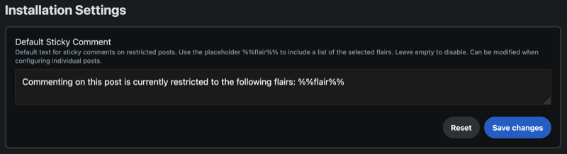
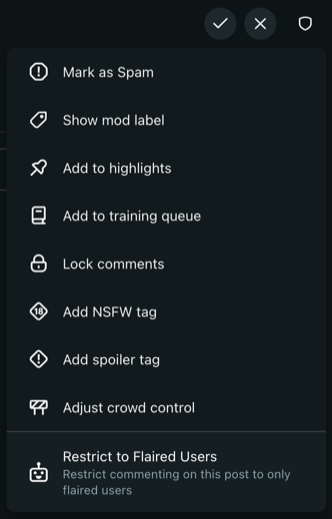
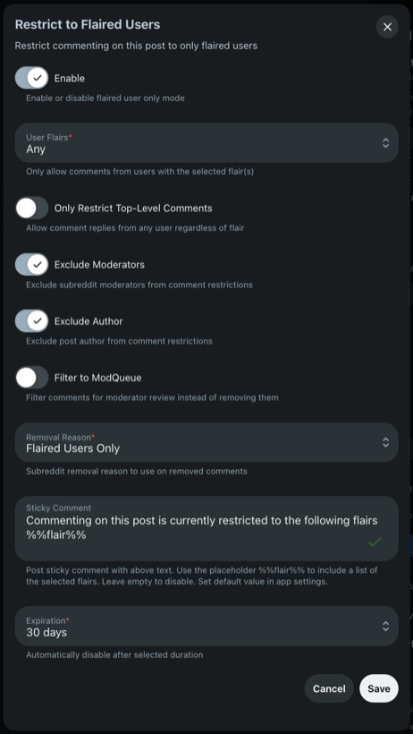
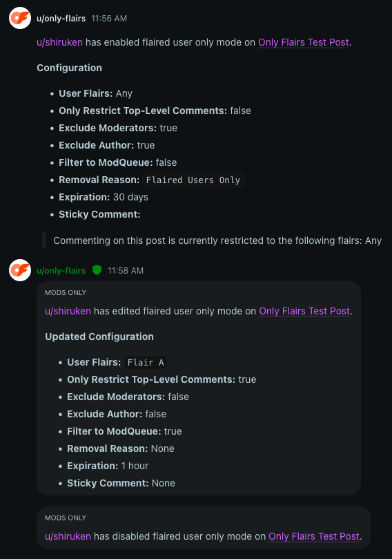
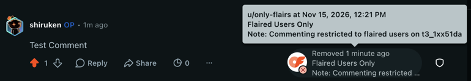
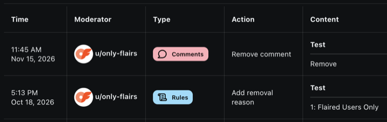
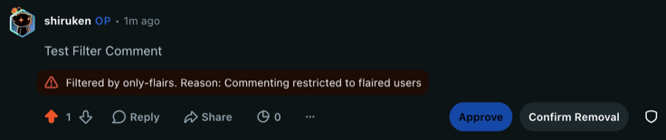
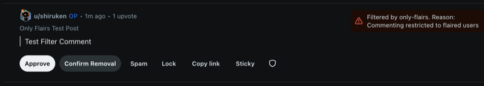
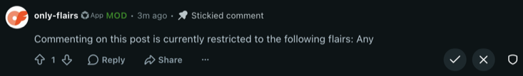

# Only Flairs

Easily restrict commenting on individual posts to only users [flaired](https://support.reddithelp.com/hc/en-us/articles/15484503095060-User-Flair) in your subreddit.

[https://developers.reddit.com/apps/only-flairs](https://developers.reddit.com/apps/only-flairs)

## Features

* Minimal setup requiring **zero** knowledge about AutoModerator or coding
* Moderator enabled on a **post-by-post** basis
* Automatically removes or filters incoming comments from unflaired users
  * Optionally filter comments to the ModQueue instead of removing them
  * Easily specify which user flairs are allowed to comment
  * Optionally allow replies to top-level comments
  * Optionally exclude subreddit moderators and post authors
  * Apply subreddit removal reason to removals
* Customizable sticky comment to inform users about restrictions
* Automatically disabled after user-selected duration
* Notifications via Modmail

## Installation Settings

* **Default Sticky Comment:** Sets the default text for sticky comments on restricted posts. Supports Markdown. Use the placeholder `%%flair%%` to include a list of the selected flairs. Leave empty to disable. Can be modified when configuring the settings on individual posts.

## Menu Action: Restrict to Flaired Users

This action appears under the moderator menu on posts in the subreddit. It allows for enabling and configuring flair-based commenting restrictions on the post.

 

* **Enable:** Enable or disable flaired user only mode (make sure to actually enable it!)
* **User Flairs:** Only allow comments from users with the selected flair(s). The 'Any' option allows any user with flair to comment.
* **Only Restrict Top-Level Comments:** Allow comment replies from any user regardless of flair
* **Exclude Moderators:** Exclude subreddit moderators from comment restrictions
* **Exclude Author:** Exclude the post author from comment restrictions
* **Filter to ModQueue:** Filter comments for moderator review instead of removing them
* **Removal Reason:** Subreddit removal reason to use on removed comments. Defaults to the last selected removal reason across the subreddit. Select 'None' to specify no removal reason.
* **Sticky Comment:** Text for the sticky comment on the post. Use the placeholder `%%flair%%` to include a list of the selected flairs. Leave empty to disable. Defaults to the value defined in the installation settings.
* **Expiration:** Automatically disable comment restrictions after selected duration

## Notifications: Modmail

A notification is routed to Modmail's **Notifications** tab when flaired user only mode is enabled on a post. Any subsequent changes to the configuration or disabling of the mode are reported as threaded updates to the original notification.

## Moderation Actions

### Comment Removal

* No removal reason will be applied if the 'Removal Reason' setting is set to 'None'

### Comment Filtering

* When 'Filter to ModQueue' is enabled, comments from unflaired users are held in the subreddit's ModQueue for moderator review instead of being removed
* Filtered comments are hidden from the post while in the queue and include the mod note: "Commenting restricted to flaired users"

### Sticky Comment

* Sticky comments will be edited or deleted as the configuration on an individual post is modified
* Manually disabling flaired user only mode will result in the sticky comment being deleted
* Sticky comments are automatically deleted when the comment restriction expires

## Changelog

*[View Releases on GitHub](https://github.com/shiruken/only-flairs/releases)*

* v0.6
  * Add option to filter comments to the ModQueue instead of removing them
  * Remember the last selected removal reason across the subreddit when configuring new posts
  * Add option to exclude post author from comment restrictions
  * Modmail notifications are now routed to the Notifications tab rather than the Inbox
  * Support multiple `%%flair%%` placeholders in sticky comments
  * Improved handling and notifications for expiring comment restrictions
  * Reliability improvements for flair detection and comment removal
* v0.5
  * Add placeholder text to include list of flairs in sticky comment
  * Add option to disable automatic expiration
* v0.4
  * Modmail notifications are now routed into the Inbox rather than Mod Discussions
  * Improved checking for presence of user flair
  * Add option to specify user flairs that are allowed to comment
* v0.3
  * Resolved issue with blank options appearing in form for Removal Reason and Expiration fields
  * Simplified form by eliminating pass-through variable
  * Default to removing comments if user flair information is missing
  * Add option to exclude moderators
* v0.2
  * Automatically post sticky comment with user-defined text
  * Specify default sticky comment text in installation settings
  * Allow specifying removal reason
  * Send Modmail on configuration change
  * Improve messaging when configuration is unchanged or form is submitted without enabling
* v0.1
  * Automatically expire restrictions after user-specified duration
  * Add option to ignore comment replies
  * If already enabled, use the current settings when displaying the form
  * Initial Release

## Links

* [Source Code](https://github.com/shiruken/only-flairs)
* [Reddit: User Flair](https://support.reddithelp.com/hc/en-us/articles/15484503095060-User-Flair)
